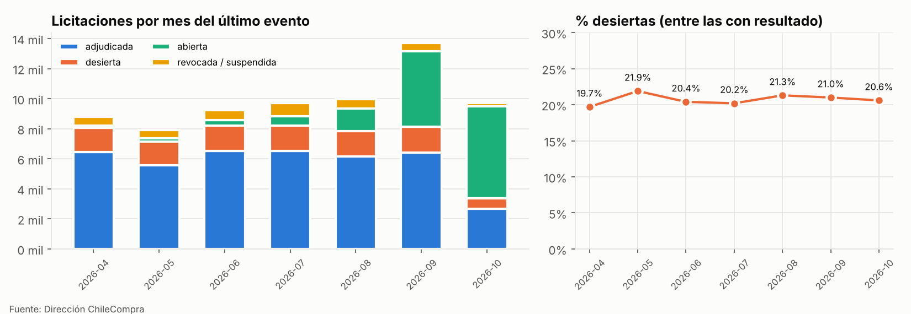
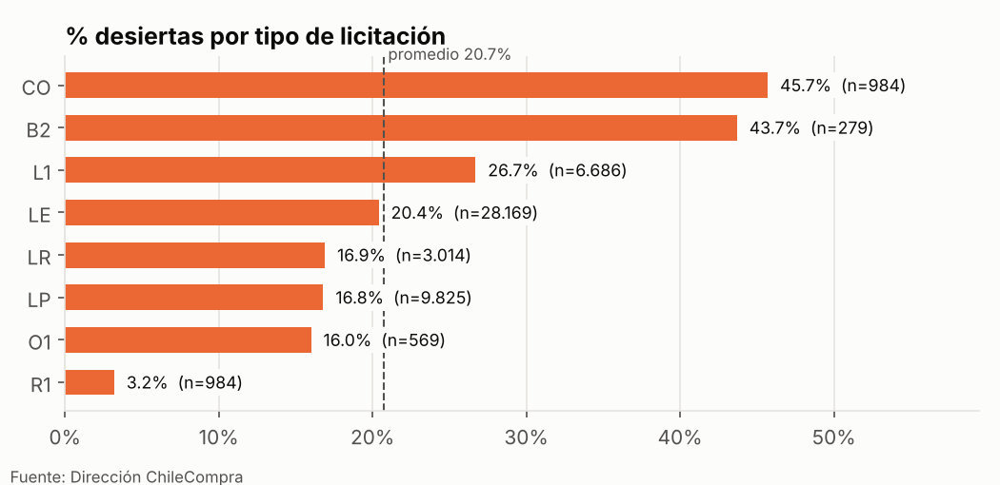

# Chilean Public Procurement — from the API to the agent

[](https://github.com/CarlosIgRuz/compras-publicas-cl/actions/workflows/ci.yml)

End-to-end data ecosystem on Chile's public procurement, built on the official Mercado Público (ChileCompra) API.
Built with AI coding agents under my direction: the decisions, validations and evaluations are mine — see [`DECISIONS.md`](DECISIONS.md) for every decision, the alternatives considered and the corrections made along the way.

> 🇨🇱 **Resumen en español** al final.

| # | Project | Skills it demonstrates | Status |
|---|---------|------------------------|--------|
| 1 | Daily pipeline + model in production (API → DuckDB → dbt → MLflow → FastAPI → drift monitoring) | ML / Data Engineering | 🚧 in progress |
| 2 | Causal study on competition in public tenders | Data Science (causal inference) | ⏳ |
| 3 | RAG + Text-to-SQL agent with its own evaluation set | AI Engineering | ⏳ |

## The question
**Will this public tender end up void ("desierta")?** — predicted at the moment it is published, so the buyer can still adjust deadlines or terms.
About **1 in 5** tenders with an outcome ends void, a remarkably stable rate month to month; it ranges from 3% to 46% across procedure types and from 8% to 27% across product categories. Only ~31% of void tenders received no bids at all: the rest got bids that were rejected.




## Preliminary results
Temporal split by publication date; every feature is known at publication time, and the buyer's history is computed point-in-time (only outcomes resolved *before* publication, enforced by a test). Full report: [`reports/modelo_resultados.md`](reports/modelo_resultados.md).

| Model (test set) | PR-AUC [95% CI] | ROC-AUC | Brier |
|---|---|---|---|
| Baseline: global rate | 0.305 | 0.500 | 0.219 |
| Baseline: historical rate by type × category | 0.355 [0.33–0.39] | 0.565 | 0.217 |
| Logistic regression | 0.442 [0.40–0.48] | 0.625 | 0.206 |
| LightGBM | 0.422 [0.39–0.46] | 0.622 | 0.217 |

> ⚠️ **Preliminary:** tender details are still being downloaded (46% coverage when trained), so the test set is skewed toward fast outcomes. Metrics will be updated once the nightly backfill completes. A shuffled-label check drops both models to ROC-AUC ≈ 0.50, as expected without leakage.

## Engineering highlights
- **Nightly ingestion on GitHub Actions** that respects the API terms: a self-imposed daily quota of 9,000 requests tracked in a versioned run log, downloads only between 22:00 and 07:00 Chile time, adaptive back-off (~1.01 requests per tender), checkpoints and per-tender retries so one API error never stops a night. Because GitHub cron triggers proved unreliable (often hours late or dropped), a scheduled external dispatcher is the primary trigger and cron is the fallback.
- **dbt + DuckDB warehouse** read straight from the raw JSON: staging, marts and a point-in-time ML table, with 34 data tests.
- **Selection-bias fix:** daily listings show each tender on the date of its *last* event, so naive cohorts over-represent quickly resolved (void) tenders. The model uses a cohort with complete outcome observability — documented in [`DECISIONS.md`](DECISIONS.md).
- **Privacy by design:** public servants' names, emails and phone numbers are dropped in staging.

## Architecture
```
Mercado Público API ──► ingest (Python, GitHub Actions) ──► data/raw (JSON, versioned)
                                    │
                                    ▼
                      DuckDB warehouse ◄── dbt (staging → marts → ml)
                           │        │
          ML model (MLflow) ◄┘        └─► Text-to-SQL + RAG agent  (project 3)
                 │
      FastAPI + drift monitoring (Evidently)  (next)
```

## Quick start
```bash
python -m venv .venv && source .venv/bin/activate   # Windows: .venv\Scripts\activate
pip install -r requirements.txt
cp .env.example .env                                 # add your API ticket
python -m compras.ingest.extract --desde 2026-09-01 --hasta 2026-09-07
dbt build --project-dir dbt --profiles-dir dbt       # builds data/warehouse.duckdb from data/raw
PYTHONPATH=src python -m compras.models.train        # trains and writes reports/
```

## Repository layout
- `src/compras/ingest` — API client, daily listings and nightly detail download
- `dbt/` — SQL transformations (staging, marts, ml)
- `src/compras/models` — training and evaluation
- `notebooks/` — exploratory analysis
- `docs/ROADMAP.md` — plan and work log (Spanish)
- `DECISIONS.md` — decision record (Spanish)
- `AGENTS.md` — rules that guide the AI agents in this repo

## Data source
Data from the Mercado Público API. **Fuente: Dirección ChileCompra** (Source: Chile's Public Procurement Directorate).
Use is governed by the [API terms of use](https://api.mercadopublico.cl): at most 10,000 requests per day per ticket; bulk downloads are scheduled between 22:00 and 07:00.

---

## 🇨🇱 Resumen en español
Ecosistema de datos de punta a punta sobre las compras públicas de Chile, construido con agentes de IA bajo mi dirección. Las decisiones, validaciones y evaluaciones son mías, y quedan en [`DECISIONS.md`](DECISIONS.md).

- **Pregunta:** ¿quedará desierta esta licitación?, predicha al momento de publicarla. Cerca de 1 de cada 5 licitaciones con resultado queda desierta.
- **Pipeline:** ingesta nocturna en GitHub Actions que respeta las condiciones de uso de la API, warehouse en DuckDB con dbt y un modelo con split temporal y variables sin fuga de información.
- **Resultados preliminares:** la regresión logística y LightGBM superan a las dos referencias simples (PR-AUC 0,44 frente a 0,36), con métricas por actualizar al completar la descarga.
- La bitácora ([`docs/ROADMAP.md`](docs/ROADMAP.md)) y las decisiones están en español.

*Fuente de los datos: Dirección ChileCompra.*
